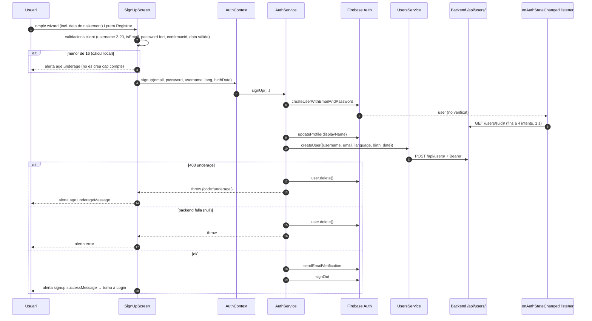

# Flux 1 — Registre (email/contrasenya)

> **[FET]** comprovat al codi · **[INFERÈNCIA]** deducció · **[NO VERIFICAT]** depèn de config externa.

## Peces
| Capa | Fitxer |
|---|---|
| Pantalla | `src/screens/SignUpScreen.tsx` (wizard: idioma → username → email → password → confirmació → data de naixement + registre) |
| Data de naixement | `src/components/BirthDateInput.tsx` (DD/MM/AAAA numèric, sense dependències natives), `src/utils/ageUtils.ts` (`buildBirthDate`, `isUnderMinAge`, `MIN_AGE = 16`) |
| Context | `src/contexts/AuthContext.tsx:125-128` (`signup`) |
| Servei | `src/services/AuthService.ts:56-102` (`signUp`) |
| HTTP | `src/services/UsersService.ts:43-62` (`createUser` → `POST /api/users/`) |
| Firebase | `src/services/firebase.ts` |

## Diagrama

## Passos
1. Validació client: username 2-20 (`SignUpScreen.tsx:105-127`), `validator.isEmail` (130-150), contrasenya ≥8 amb minúscula, majúscula, dígit i `!@#$%^&*` (198-216), confirmació (178-196).
2. `handleSignUp` (218-289) crida `signup`. L'error `emailInUse` s'emmascara com a `signup.errors.registrationFailed` (L282).
3. `AuthService.signUp`: `createUserWithEmailAndPassword` → `updateProfile` → `getIdToken` → `UsersService.createUser` (amb `birth_date`) → si llança `underage` o retorna `null`, `firebaseUser.delete()` → `sendEmailVerification` (ara **després** de crear l'usuari al backend) → `signOut`.
4. El backend **no desa** la data de naixement: només `age_confirmed_at` i `age_threshold=16` (minimització, vegeu docs del backend). El GET d'usuari exposa `age_confirmed`.
5. L'usuari no entra a l'app fins que verifica l'email: `isAuthenticated = !!firebaseUser && firebaseUser.emailVerified` (`AuthContext.tsx:245`).

## Gotchas i bugs
- ~~El correu de verificació s'envia abans de crear l'usuari al backend~~ **Resolt** (feature `images`): s'envia després del `POST /users/`.
- El body de `POST /users/` inclou `email`, que el backend no espera (`UsersService.ts:11-16`) **[FET]**; el backend l'ignora **[INFERÈNCIA]**.
- L'idioma triat al wizard es canvia amb `i18n.changeLanguage` directe (`SignUpScreen.tsx:73`), no amb el helper que el desa a AsyncStorage **[FET]**.
- ~~Clau i18n inexistent `signup.errors.usernameTooShort`~~ **Resolt**: afegida a les 4 locales.
- ~~String hard-coded `'Si us plau, selecciona un idioma'`~~ **Resolt**: `signup.errors.selectLanguage`.
- Els termes i condicions (`src/components/TermsAndConditionsModal.tsx`) només s'obren des de Login i no es registra cap acceptació **[FET]**.
- El listener d'auth fa reintents de `GET /users/{uid}/` mentre `signUp` encara crea l'usuari, sense guarda de cancel·lació → `backendUser` pot quedar desfasat **[INFERÈNCIA]** (`AuthContext.tsx:53-110`).
- Usuaris existents i de Google no passen pel wizard: `AppNavigator` mostra `AgeGateScreen` si `backendUser.age_confirmed === false` (vegeu [flows/03](03-profile-settings-account.md#confirmació-dedat-agegatescreen)) **[FET]**.
