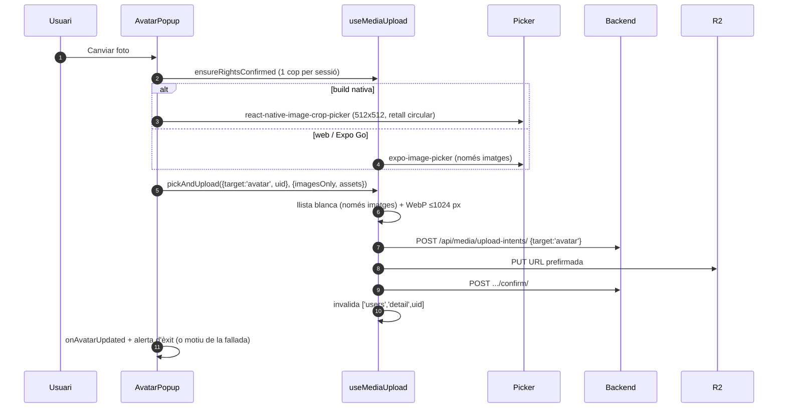
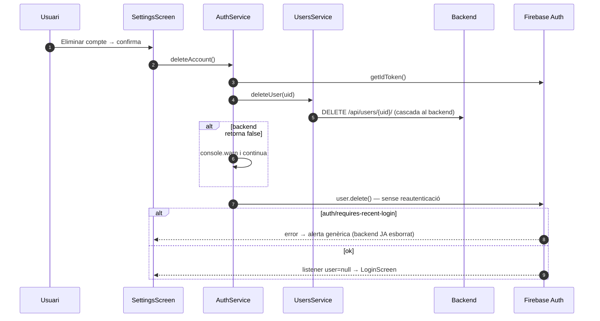

# Flux 3 — Perfil, avatar, configuració, idioma i esborrat de compte

> **[FET]** comprovat al codi · **[INFERÈNCIA]** deducció · **[NO VERIFICAT]** depèn de config externa.

## Pantalles i peces
| Funcionalitat | Entrada | Servei / Firebase |
|---|---|---|
| Veure perfil | `src/screens/ProfileScreen.tsx` (`useUser`, `useVisitedRefuges`, L40-41) | `GET /api/users/{uid}/`, `GET /api/users/{uid}/visited-refuges/` |
| Avatar | `src/components/AvatarPopup.tsx` + `useMediaUpload` (target `avatar`) | `POST /api/media/upload-intents/` → PUT R2 → `confirm`; `DELETE /api/users/{uid}/avatar/` |
| Confirmació d'edat | `src/screens/AgeGateScreen.tsx` (des d'`AppNavigator`) → `AuthContext.confirmAge` | `PATCH /api/users/{uid}/age-confirmation/` |
| Avisos de moderació | `src/components/ModerationNoticesCard.tsx` al perfil (`useModerationNotices`) | `GET /api/users/{uid}/moderation-notices/` |
| Gestió de denúncies (admin) | `SettingsScreen` → `MediaReportsScreen` | `GET/PATCH /api/admin/media-reports/` |
| Nom d'usuari | `src/screens/EditProfileScreen.tsx:51-91` → `AuthContext.updateUsername` (198-219) | `PATCH /api/users/{uid}/` |
| Email | `src/screens/ChangeEmailScreen.tsx:51-109` → `AuthService.changeEmail` (421-463) | Firebase `reauthenticateWithCredential` + `verifyBeforeUpdateEmail` |
| Contrasenya | `src/screens/ChangePasswordScreen.tsx:82-142` → `AuthService.changePassword` (392-411) | Firebase `reauthenticateWithCredential` + `updatePassword` |
| Idioma | `src/screens/SettingsScreen.tsx:91-101` → `src/components/LanguageSelector.tsx:23-61` | `changeLanguage` + `PATCH /api/users/{uid}/ {language}` |
| Esborrar compte | `src/screens/SettingsScreen.tsx:153-177` → `AuthService.deleteAccount` (317-342) | `DELETE /api/users/{uid}/` + `user.delete()` |

## Diagrama — pujar avatar

## Confirmació d'edat (AgeGateScreen)
- `AppNavigator` retorna `AgeGateScreen` en lloc de l'app si `backendUser.age_confirmed === false` (usuaris anteriors a la feature i de Google). Si el backend no envia el camp (`undefined`), no es bloqueja.
- Validació local (`buildBirthDate`, `isUnderMinAge`); `confirmAge(iso)` → `PATCH /api/users/{uid}/age-confirmation/ {birth_date}` → `age_confirmed = true` al context i invalidació de `['users','detail',uid]`.
- < 16 (local o `403 underage`): missatge `age.underageMessage` i `logout()`.

## Avisos de moderació
- `ModerationNoticesCard` (perfil) llegeix `GET /api/users/{uid}/moderation-notices/` (clau `['users', uid, 'moderationNotices']`) i mostra acció, motiu, declaració de motius, strikes i el correu per recórrer (placeholder a `src/config/legal.ts`). No es mostra si no n'hi ha.

## Diagrama — esborrar compte

## Gotchas i bugs
- **Esborrat de compte**: backend primer, Firebase després i sense reautenticar. Si Firebase demana login recent, queda un compte d'Auth sense fila al backend; al següent login `GET /users/{uid}/` fa 404 i `backendUser` queda `null` **[FET ordre / INFERÈNCIA conseqüència]** (`AuthService.ts:328-335`).
- **Idioma**: `UsersService.updateUser` retorna `null` en lloc de llançar → `onError` no s'executa; `onSuccess` fa `reloadUser`, que torna a llegir l'idioma **antic** del backend i reverteix la UI **[FET + INFERÈNCIA]** (`LanguageSelector.tsx:37-49`, `src/hooks/useUsersQuery.ts:376-381`).
- Idioma enviat en **majúscules** (`'CA'`, `LanguageSelector.tsx:35`) però en minúscules al registre i a Google (`AuthService.ts:82,180`); el lector fa `toLowerCase()` (`AuthContext.tsx:86`) **[FET]**. El backend valida `ca|es|en|fr` **[NO VERIFICAT si accepta majúscules]**.
- Canviar email **no** actualitza res al backend; la branca `BACKEND_UPDATE_FAILED` (`ChangeEmailScreen.tsx:101`) és codi mort **[FET]**.
- Canviar email/contrasenya s'ofereix també a usuaris de Google, però la reautenticació usa `EmailAuthProvider` **[FET]** → no pot funcionar **[INFERÈNCIA]**.
- `updateUsername` envia el valor sense `trim()` (`EditProfileScreen.tsx:73`) i no actualitza el `displayName` de Firebase **[FET]**.
- La pujada de l'avatar ara passa per `useMediaUpload` (invalida `['users','detail',uid]`); l'esborrat continua cridant `UsersService.deleteAvatar` directament amb callback de refetch **[FET]**.
- ~~Claus `profile.avatar.expoGo*`~~: ja no s'usen (a Expo Go l'avatar es tria amb `expo-image-picker`).
