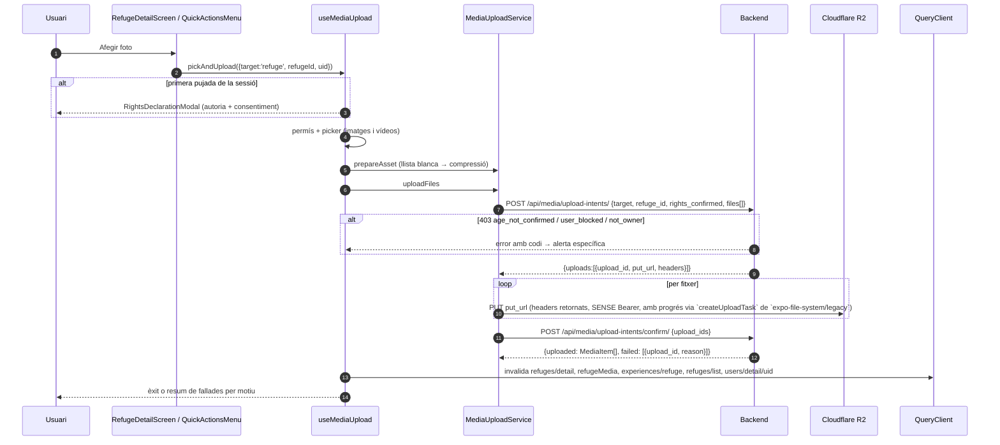
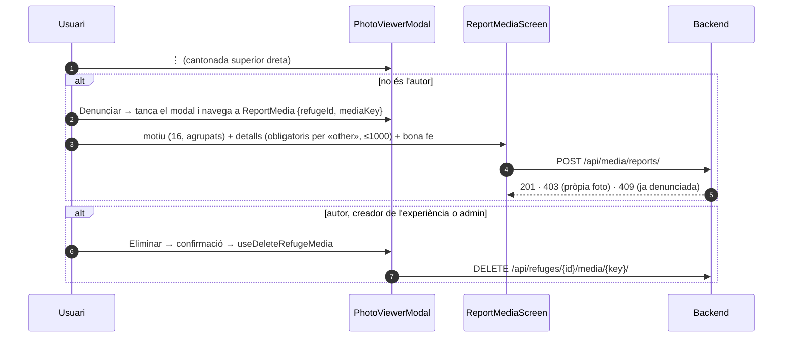

# Flux 9 — Pujar fotos/vídeos a un refugi, galeria, denúncia i esborrat

> **[FET]** comprovat al codi · **[INFERÈNCIA]** deducció · **[NO VERIFICAT]** depèn de config externa.
> Feature `images` (octubre 2026): pujada amb **URL PUT prefirmada** a `quarantine/` + `confirm`; el backend recodifica (neteja EXIF/GPS), genera miniatura i blurhash. Contracte: [integrations/backend-api.md §Mitjans](../integrations/backend-api.md#mitjans-moderació-i-edat-feature-images).

## Peces
| Capa | Fitxer |
|---|---|
| Hook únic de pujada | `src/hooks/useMediaUpload.ts` (`pickMedia`, `pickAndUpload`, `uploadPrepared`, `rightsModalProps`, `progress`) |
| Servei | `src/services/MediaUploadService.ts` (llista blanca, compressió, `createUploadIntents`, `putFile`, `confirmUploads`, `uploadFiles`) |
| Declaració de drets | `src/components/RightsDeclarationModal.tsx` + `src/services/mediaSession.ts` (1 cop per sessió; es reinicia al logout) |
| Invalidacions | `src/hooks/mediaInvalidation.ts` (`invalidateMediaQueries`, registre `queryKeys`) |
| Entrades UI | `RefugeDetailScreen.handleUploadPhotos` (carrusel, galeria buida) i `QuickActionsMenu` (prop `onAddPhoto`, delega al pare) |
| Renderitzat | `src/components/MediaImage.tsx` (`expo-image`), `src/components/MediaThumbnail.tsx` (miniatura / pòster / fallback `VideoThumbnail`) |
| Galeria | `src/screens/GalleryScreen.tsx` (graella de 3 columnes amb `thumb_url`) |
| Visor | `src/components/PhotoViewerModal.tsx` (imatge completa, menú ⋮) |
| Denúncia | `src/screens/ReportMediaScreen.tsx` (ruta de pila `ReportMedia`), `src/hooks/useMediaModerationQuery.ts` (`useReportMedia`), `src/services/MediaModerationService.ts`, `src/utils/mediaReportReasons.ts` |
| Esborrat | `useDeleteRefugeMedia` (`src/hooks/useRefugeMediaQuery.ts`) → `RefugeMediaService.deleteRefugeMedia` |
| Admin | `src/screens/MediaReportsScreen.tsx` (ruta `MediaReports`, des de Configuració) |

## Llista blanca i compressió (client)
- Picker (`expo-image-picker`): `mediaTypes: ['images','videos']` (avatar: `['images']`), màx. 10, `videoMaxDuration: 60`, `quality: 1`.
- `MediaUploadService.validateAsset`: MIME **i** extensió han de ser a la llista (`jpeg/jpg/png/webp/heic/heif`, `mp4/mov(quicktime)/webm`) i ser de la mateixa categoria; si no hi ha cap dels dos, es rebutja. Els rebutjats es resumeixen en un avís (`media.errors.rejectedTitle`) i **no s'envien mai**.
- Imatges: `expo-image-manipulator` → costat llarg ≤ 2048 px, WebP q 0.8 (`image/webp`); > 15 MB → `too_large`.
- Vídeos: `react-native-compressor` (`Video.compress`, H.264/MP4) si el mòdul natiu hi és; > 60 s → `too_long` (sense comprimir); > 50 MB després de comprimir → `too_large`. Sense mòdul natiu (Expo Go/web) es puja l'original si compleix els límits.

## Diagrama — pujar

## Diagrama — denunciar i esborrar (menú ⋮)

## Visualització
- `MediaImage` (expo-image): `cacheKey` = clau R2 (`key` o `key#thumb`), així la cache a disc sobreviu al canvi de URL prefirmada; `placeholder` = `blurhash`; `cachePolicy="disk"`.
- Galeria/carrusel: `thumb_url`; visor: `url` completa (`contentFit="contain"`); vídeos nous: pòster (`thumb_url`) amb icona ▶; vídeos antics sense pòster: primer fotograma amb `expo-video`.
- Items antics (sense `thumb_url`, `blurhash`, `media_type`): fallback a `url` i detecció de vídeo per extensió **[FET]**.

## Gotchas i bugs
- El `<Modal>` del visor queda sempre per sobre de la pila: cal **tancar-lo abans de navegar** a `ReportMedia` **[FET]**. Si el detall del refugi és un overlay d'`AppNavigator`, s'amaga mentre `ReportMedia`/`MediaReports` és al cim de la pila (`ROUTES_ABOVE_OVERLAYS`) **[FET]**.
- Els permisos del menú ⋮ (`getPhotoMenuPermissions`) són visuals; el backend autoritza (403) **[FET]**.
- El correu de contacte per a recursos és un placeholder (`src/config/legal.ts`) **[FET]**.
- `react-native-compressor` és natiu: cal un build EAS/dev client nou; a Expo Go els vídeos es pugen sense recomprimir **[FET]**.
- El backend és autoritatiu (magic bytes, recodificació): la compressió del client només estalvia dades **[INFERÈNCIA de disseny]**.
