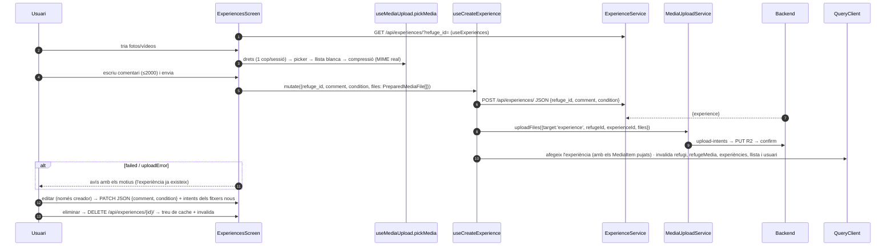

# Flux 11 — Experiències

> **[FET]** comprovat al codi · **[INFERÈNCIA]** deducció · **[NO VERIFICAT]** depèn de config externa.

## Peces
| Capa | Fitxer |
|---|---|
| Pantalla | `src/screens/ExperiencesScreen.tsx` (overlay des d'`AppNavigator.tsx:326-338`) |
| Element | `src/components/UserExperience.tsx` (edició inline) |
| Preview | `src/screens/RefugeDetailScreen.tsx:999-1042` |
| Hooks | `src/hooks/useExperiencesQuery.ts` (clau `queryKeys.refugeExperiences(id)`) · selecció de fitxers amb `useMediaUpload().pickMedia` |
| Servei | `src/services/ExperienceService.ts` |
| Mapper | `src/services/mappers/ExperienceMapper.ts:8-19` |

Endpoints, formes de resposta, errors per status i ús dels hooks: [reference/experience-service.md](../reference/experience-service.md).

## Diagrama

## Gotchas i bugs
- El botó d'editar/eliminar només es mostra si `backendUser.uid === creator_uid`; amb la feature `images` el backend comprova la propietat (403 / `not_owner` als intents) **[NO VERIFICAT des del frontend]**.
- ~~MIME forçat i `MediaTypeOptions.All`~~ **Resolt**: la selecció passa per `useMediaUpload.pickMedia` (MIME real, WebP després de comprimir).
- Si el PATCH no retorna `experience`, no se substitueix a la cache (però amb fitxers sí que s'invalida); el PATCH es fa sempre (porta `condition`, que l'app envia sempre) **[FET]**.
- `condition` (0-3, estat del refugi) és **obligatori en crear**: `ExperiencesScreen` mostra `ExperienceConditionPicker` i desactiva l'enviament fins triar-ne un; en editar, `UserExperience` el precarrega i no deixa confirmar si l'experiència antiga no en té. El servei valida l'enter 0-3 abans de la petició **[FET]**.
- En crear, el `comment` no pot ser buit (el backend respon 400): l'enviament queda desactivat sense comentari, també si hi ha fotos, amb l'avís `experiences.commentRequired` **[FET]**.
- 403 `user_blocked` / `age_not_confirmed` al POST/PATCH: `ApiError` amb `code` i alerta via `getContentErrorMessage` (igual que visites, reformes i dubtes) **[FET]**.
- `UserExperience.formatDate` només entén ISO/`yyyy-mm-dd` i si no mostra 'Sense data' (63-90); el DTO diu `DD/MM/YYYY` (`src/services/dto/ExperienceDTO.ts:11`) **[FET]**; format real del backend: **[NO VERIFICAT des del frontend]**.
- `refuge_id` sense codificar a la query (`ExperienceService.ts:49`) **[FET]**.
- ~~`alert()` global i clau `refuge.gallery.permissionDenied`~~ **Resolt**: `UserExperience` rep `onPickMedia` del pare.
- ~~`deleteMediaMutation` sense ús~~ **Resolt** (eliminat).
- Si la creació va bé però la pujada falla (p. ex. `user_blocked`), l'experiència queda creada sense fotos i es retorna `uploadError` **[FET]**.
