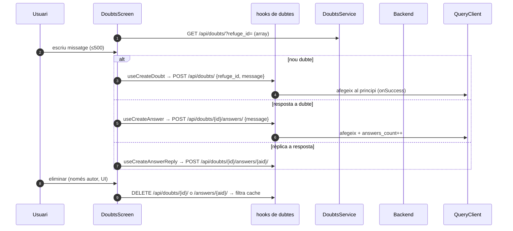

# Flux 12 — Dubtes i respostes

> **[FET]** comprovat al codi · **[INFERÈNCIA]** deducció · **[NO VERIFICAT]** depèn de config externa.

## Peces
| Capa | Fitxer |
|---|---|
| Pantalla | `src/screens/DoubtsScreen.tsx` (overlay `AppNavigator.tsx:313-324`) |
| Missatge | `src/components/UserMessage.tsx` |
| Hooks | `src/hooks/useDoubtsQuery.ts` (clau `['doubts','refuge',id]`) |
| Servei | `src/services/DoubtsService.ts` |
| Mapper | `src/services/mappers/DoubtMapper.ts:23-33` |

## Diagrama

## Gotchas i bugs
- Els botons d'eliminar es mostren al creador **i a l'admin** (`UserMessage.tsx`, `useIsAdmin`: claim `role` del token); és només visual (gotcha 17). El backend nou respon `403 {code:'not_owner'}` a qui no és creador ni admin: `DoubtsService.deleteDoubt/deleteAnswer` llancen `ApiError` i `DoubtsScreen` mostra `contentErrors.notOwner` **[FET]**.
- Escriptures (`createDoubt`, `createAnswer`, `createAnswerReply`): poden respondre 403 `user_blocked`/`age_not_confirmed` → `ApiError` amb `code`, missatge traduït via `getContentErrorMessage` **[FET]**.
- Esborrar una resposta esborra tot el seu subarbre al backend: `useDeleteAnswer` treu la resposta i els descendents de la cache (`collectAnswerSubtreeIds`) i invalida `['doubts','refuge',id]` perquè es refaci la consulta **[FET]**. `answers` ve sempre (`[]` si no n'hi ha) **[FET]**.
- Les rèpliques es mostren planes: `parent_answer_id` s'ignora a la UI (`DoubtsScreen.tsx:82-94`) **[FET]**.
- Els comentaris diuen "optimistic" però les escriptures a cache es fan a `onSuccess` **[FET]**.
- `refuge_id` ara es codifica amb `encodeURIComponent` **[FET]**.
- Hooks dins `try/catch` (`DoubtsScreen.tsx:105-110`) **[FET]**.
